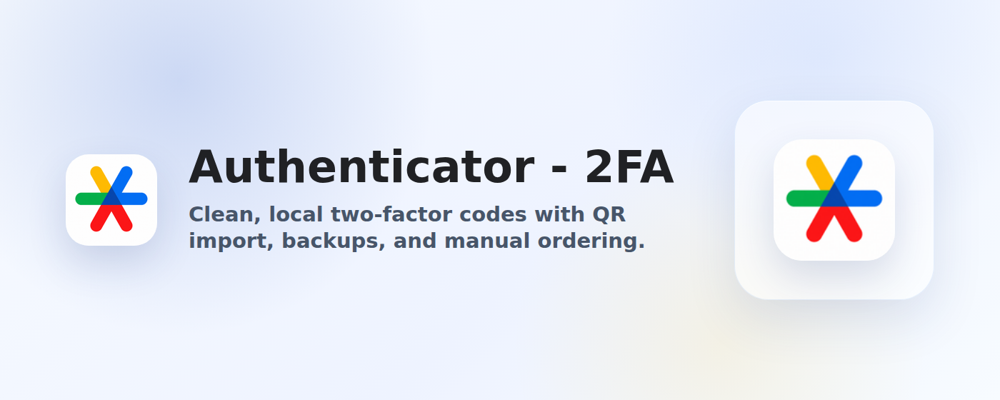

# Authenticator - 2FA

Browser extension for generating and managing two-factor authentication codes.

**Privacy:** Authenticator - 2FA does not track users or collect analytics. Accounts stay on your device by default. If you enable Browser Sync, encrypted account data is sent through your browser provider's sync service. Account names and secrets are encrypted before upload; the recovery key stays inside your password-protected local vault.



## Install

[](https://chromewebstore.google.com/detail/authenticator-2fa/pphhggggadbehnhklioamemafkeegfjf)
[](https://microsoftedge.microsoft.com/addons/detail/lngkiejjggjenmeelgcadhilloeffkdl)
[](https://addons.mozilla.org/en-US/firefox/addon/authenticator-2fa/)

## Features

- Generate TOTP, HOTP, and Steam-style 2FA codes.
- Add accounts from QR images, page QR scans, pasted otpauth text, or manual entry.
- Search, copy, manually reorder accounts, or focus on likely codes for the current site with one-click access to the rest.
- Import by dropping or picking QR images, otpauth text, JSON, or password-protected backups; export the same way.
- Optional local vault password protection.
- Optional encrypted Browser Sync across supported devices using the same browser account.
- Local-first storage with no account service.

**Important: Users are responsible for maintaining their own backups of 2FA codes and recovery methods. We are not responsible for lost, deleted, inaccessible, or unrecoverable 2FA codes.**

## Browser Sync

Open **Settings → Browser Sync**, set a local vault password, choose **Set up sync**, and save the generated recovery key. On another supported device, sign into the same browser account, choose **Connect to existing sync**, and enter that key. Enable extension syncing in your browser settings.

Sync works within one browser provider. Accounts, edits, and deletions sync while the extension is open and unlocked; preferences and ordering stay local. Keep independent backups and use HOTP accounts on one device at a time.

See [sync security, recovery, and limits](docs/browser-sync.md).

## Development

Use Node.js 24 and the pnpm version pinned in `package.json` (12.11.2).

```sh
pnpm install
pnpm run dev
```

Useful commands:

```sh
pnpm run check
pnpm run test
pnpm run build
pnpm run package
```

`pnpm run package` builds extension zips for `chrome`, `edge`, and `firefox` into `artifacts/`.

## Store Assets

Project assets are grouped under `assets/` by lifecycle:

- `assets/brand/` source artwork for generated extension icons
- `assets/extension/` static files copied into extension packages
- `assets/store/` store icons, screenshots, and promo tiles kept outside the extension bundle

Regenerate screenshots and promo tiles with:

```sh
pnpm run store:screenshots
```

This command uses synthetic demo accounts and a local browser to render store-ready images.
Temporary store listing text drafts can live in `.tmp/store-listing/`, which is ignored by git.

## Releases

Pushing a tag like `v1.2.3` runs the release workflow. The workflow applies the tag version, builds all targets, packages the zips, creates the GitHub release, and uploads the browser extension assets.

## Origins

Authenticator - 2FA was inspired by the open-source [Authenticator browser extension](https://github.com/Authenticator-Extension/Authenticator). This project is a complete from-scratch rewrite, created after that extension became unmaintained, with a new codebase focused on fixing many long-standing issues while preserving a simple local-first authenticator workflow.

## License

MIT
